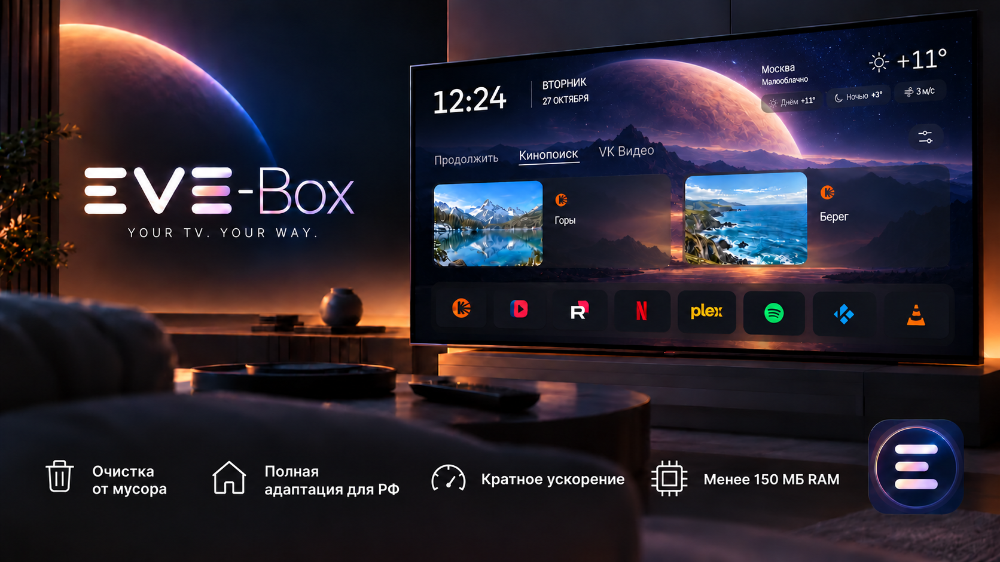
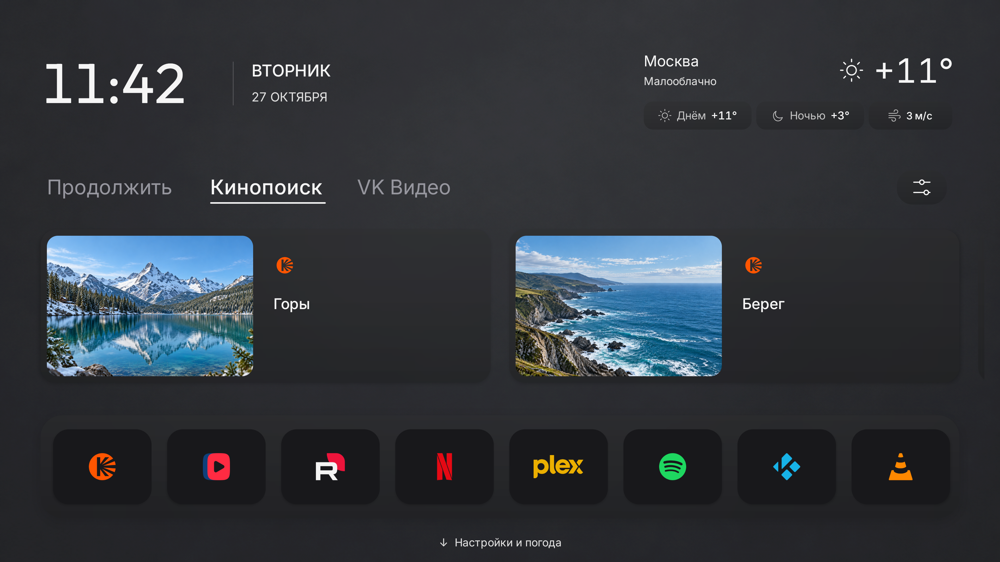
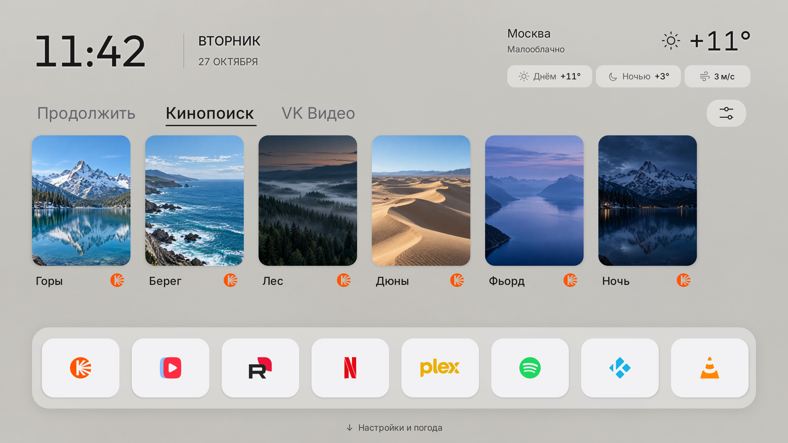
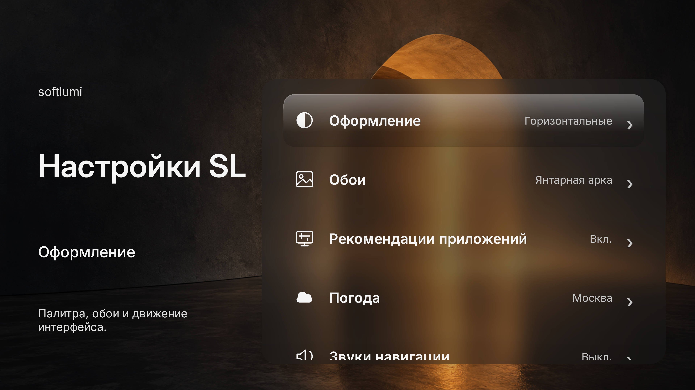
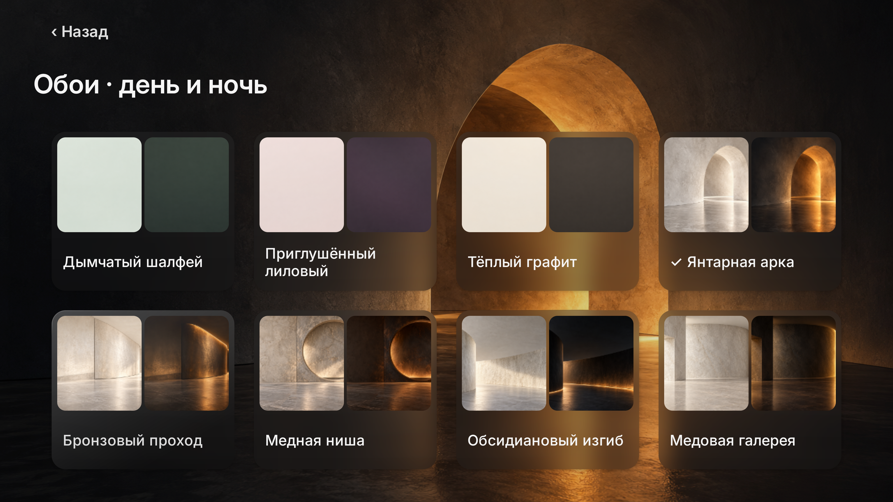
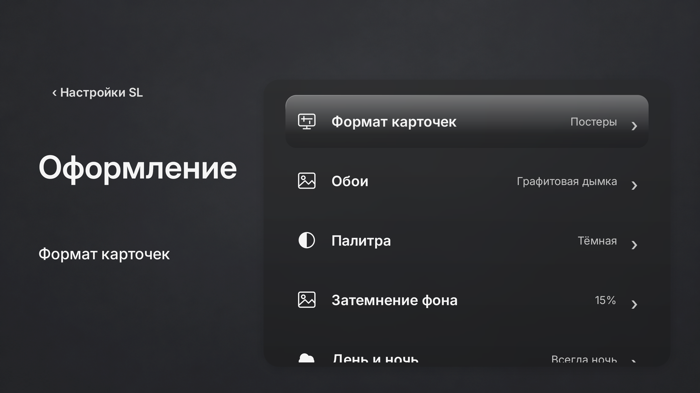
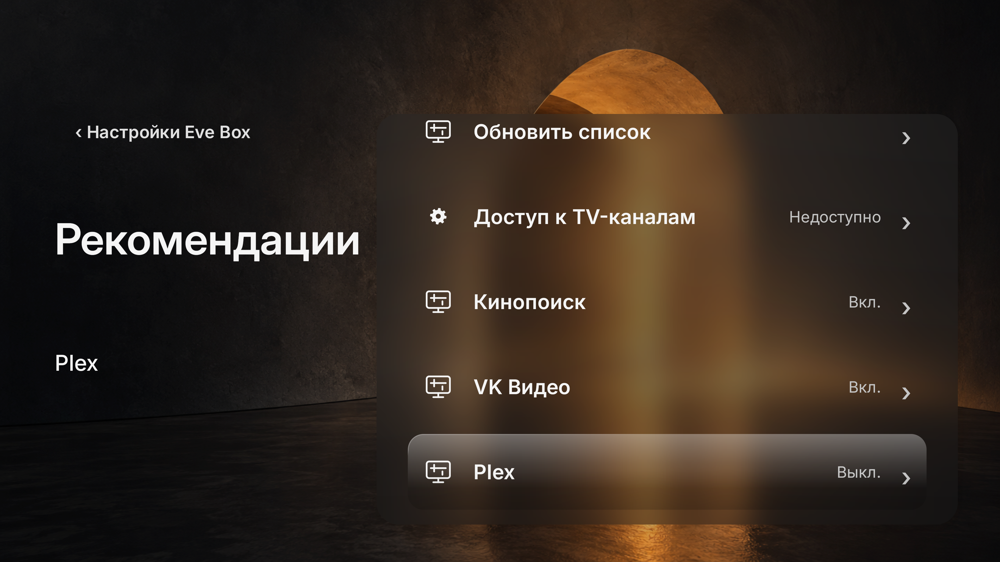
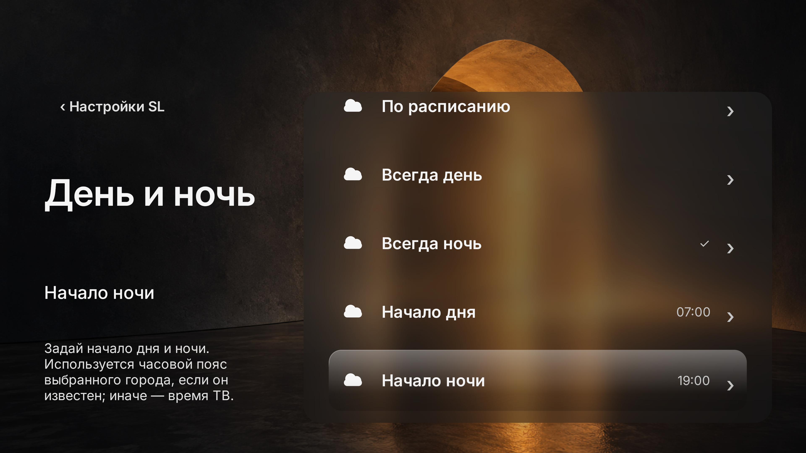
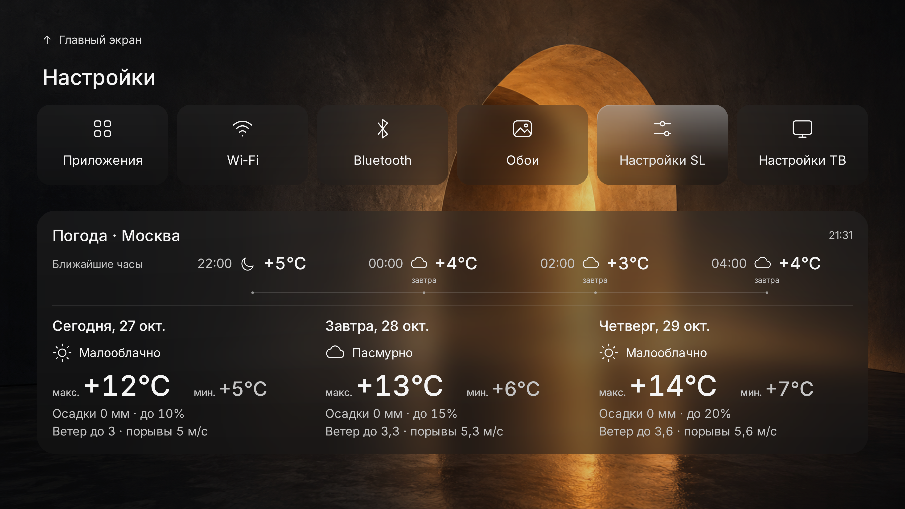

# EVE-BOX

**An Android TV launcher with a customizable home screen.**

Favorite apps, continue-watching cards and weather share one screen. The
interface is designed for a remote: choose a card layout, manage recommendations
and set up automatic switching between daytime and nighttime appearance.

[Download](https://github.com/ekkzy/softlumi/releases/tag/v0.3.0-candidate.14-setup.2) · [Installation](#installation) · [Русский](README.md) · [Build](docs/building.en.md)



## About the project

EVE-BOX started with a wish to make my own TV box easier to use and more
responsive. I wasn't satisfied with the stock interface's speed. After
disabling apps I didn't need, I began building a launcher around Russian
streaming services and my everyday viewing habits.

The project is developed with help from AI and tested on my Xiaomi Mi Box S 3.
Before the first GitHub publication, I used it daily for a week while refining
the interface, navigation and memory use. Suggestions and bug reports are welcome.

## What's inside

- **Your apps, within reach.** Up to eight favorites, custom ordering, hidden
  apps and a separate app catalog. Logos keep their colors, with accessible
  names available to assistive technology.
- **Two card formats.** Wide cards with large artwork or portrait posters.
  Changing the format keeps your favorites and appearance settings.
- **Continue watching and recommendations.** Personal Android Watch Next cards
  stay separate from recommendations. Recommendations have one switch per app
  in settings and one app tab on the home screen.
- **Appearance through the day.** Twenty background choices with day and night
  states, light and dark palettes, and adjustable dimming. Choose the period
  automatically, by schedule or manually.
- **Weather for your chosen city.** Current conditions, upcoming hours and a
  three-day forecast. Weather is optional and needs no location permission.

## Interface and settings



These screenshots show the real interface with demonstration cards and weather,
without personal viewing history. Available publications depend on installed apps.
Below are dark appearance, the wallpaper gallery and settings operated with a remote.
Open any image to view it at full resolution.

| Dark appearance and posters | Main settings |
| --- | --- |
|  |  |

| Wallpaper gallery | Card format, palette and dimming |
| --- | --- |
|  |  |

| Recommendations by app | Day and night settings |
| --- | --- |
|  |  |



## Installation

The [current release](https://github.com/ekkzy/softlumi/releases/tag/v0.3.0-candidate.14-setup.2) offers three installation methods.
Choose whether you only need the app or also want to configure the TV box.

| Method | Download | Requirements |
| --- | --- | --- |
| **APK only** | [softlumi-0.3.0-candidate.14.apk](https://github.com/ekkzy/softlumi/releases/download/v0.3.0-candidate.14-setup.2/softlumi-0.3.0-candidate.14.apk) | Transfer the file to your TV and open it with an installer. A PC and AI are optional. |
| **With an AI assistant** | [softlumi-ai-setup-candidate.14.zip](https://github.com/ekkzy/softlumi/releases/download/v0.3.0-candidate.14-setup.2/softlumi-ai-setup-candidate.14.zip) | Windows, an assistant with terminal access, ADB, Java 17 and Android SDK Build-Tools. |
| **One command through ADB** | [EVE-BOX-setup-candidate.14.zip](https://github.com/ekkzy/softlumi/releases/download/v0.3.0-candidate.14-setup.2/EVE-BOX-setup-candidate.14.zip) | Windows and ADB. No AI, Java or Android Studio required. |

### 1. Install the APK manually

Download the APK, transfer it to your TV and open it with a file manager.
If Android asks, allow that file manager to install apps. This installs the
launcher; app disabling and default Home selection are separate actions.
[Step-by-step guide](docs/installation.en.md).

### 2. Install with an AI assistant

Extract the AI kit and give the [ready-made prompt](docs/installation-prompt-ru.md)
to an assistant with local terminal access, such as Codex or Claude Code.
The assistant checks the connection and presents a plan before changing anything.
[Guide and requirements](docs/ai-setup.md).

### 3. Install and clean up through ADB

Extract the EVE-BOX kit, enable debugging on the TV and run from the kit folder:

```powershell
.\install.cmd
```

The wizard asks you to select a device or enter its IP, choose apps to disable
and confirm the plan. [Detailed guide in Russian](docs/one-command-setup-ru.md).

In both installers, cleanup and Home selection require the exact supported
Mi Box S 3 firmware. Other devices get APK installation only. App disabling is
explicit and preserves app data. Keep the journal for inspection and restoration
of recorded package and Home states. Remote services and sleep timers are preserved.

This is a prerelease in a private repository; downloads require access.
EVE-BOX is the new project name. The APK still identifies itself as
**softlumi 0.3.0-candidate.14**, code35, with the same package and signing key.
Updates preserve application data. Download hashes are in `SHA256SUMS.txt`.

Android TV 8.0 or later and a D-pad remote are required. The primary development
device is Xiaomi Mi Box S 3. TV data access and default Home selection depend
on the firmware. Live blur is available on Android 12 and later; earlier
versions use a translucent material.

## A few things to know

Viewing cards depend on installed apps publishing accessible Android TV data.
softlumi does not connect to streaming accounts or promise a complete viewing
history or exact resume for every video. Source apps are selected explicitly;
private or unavailable publications are not bypassed.

There are no ads, analytics or project-operated servers. Settings stay on the
device and can be exported manually as JSON. Imports show a preview before
applying any changes. Weather and poster loading contact their respective
external sources; see
[privacy](docs/privacy.en.md).

## Resources

The comparison below describes `candidate.12`, before the memory changes in
`candidate.13`; it does not describe the new APK in the setup kit.
Four pairs of short idle observations were collected on a Xiaomi Mi Box S 3.
Median resident PSS excluding swapped-out pages was **96.5 MiB** for softlumi
and **121.3 MiB** for Google TV Home. Swap was **43.0 and 0.4 MiB** separately.
The earlier 139.5/121.7 MiB values are Android's `TOTAL PSS`, which includes swap;
they are not entirely resident RAM. Median process CPU was 0.033% and
0.066% of one core respectively. The softlumi APK is larger:
44.85 versus 23.54 MiB, almost all of it bundled wallpapers.
These observations do not establish overall resource savings.
[Results, versions and limits](docs/performance.en.md).

## For developers

Java 17 and native Android Views, without Compose or a third-party UI framework.
The [build guide](docs/building.en.md) covers the toolchain and checks.
See [CONTRIBUTING.md](CONTRIBUTING.md) for change and verification guidelines.
See [SECURITY.md](SECURITY.md) for security reporting.

Code is licensed under [MIT](LICENSE). Fonts, logos, weather data and images
have separate terms listed in [third-party notices](THIRD_PARTY_NOTICES.md).

[EVE-BOX logos and brand kit](docs/brand/README-RU.md) · [Download brand kit ZIP](https://github.com/ekkzy/softlumi/releases/download/v0.3.0-candidate.14-setup.2/EVE-BOX-brand-kit.zip).
